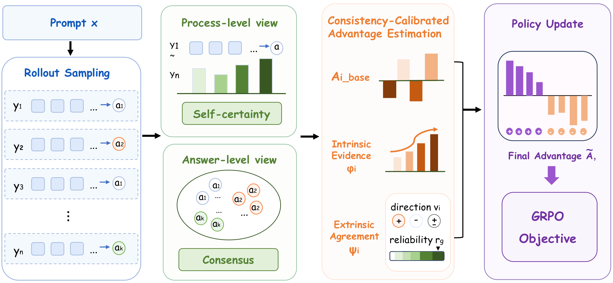

# Consistency-Calibrated Advantage Estimation for Label-Free Reinforcement Learning

[](https://aclanthology.org/2026.emnlp-main.2484/)

**CCAE** is a label-free advantage estimator for GRPO-style reinforcement learning on LLM reasoning. It scores each rollout by the model's self-certainty over its own reasoning and by how well its answer agrees with the rest of the group, then calibrates how the two signals interact by how reliable that agreement is for the prompt. It needs no reference answers, reward model, or trainable parameters. CCAE-NR extends CCAE to free-form natural reasoning.



## Results

On MATH with Qwen3-4B-Base, CCAE reaches 52.2 average Pass@1 across six benchmarks, +5.0 over the strongest label-free baseline and on par with GRPO trained on gold labels (52.0), exceeding it on MMLU-STEM and GPQA-Diamond. On DAPO-Math-14k, CCAE trains stably where prior label-free methods collapse. Full results in the paper.

## Setup

8 × NVIDIA A800 80GB, FSDP backend.

```bash
conda create -n ccae python=3.10
conda activate ccae
pip install -r requirements.txt
pip install -e .
```

## Data

- **MATH**: `python examples/data_preprocess/process_math.py --input_dir <MATH-lighteval>/data --output_dir ~/data/math_train`
- **DAPO-Math-14k**: the 14k English split (`en`) of [DAPO-Math-17k-Processed](https://huggingface.co/datasets/open-r1/DAPO-Math-17k-Processed), converted to chat-format parquet (see `process_math.py` for the format)
- **Natural Reasoning**: 10k questions randomly sampled from [NaturalReasoning](https://huggingface.co/datasets/facebook/natural_reasoning) after filtering out questions with over-long prompts or reference answers for training efficiency; included in `data/natural_reasoning/` (CC BY-NC 4.0)

## Training

Set `MODEL_PATH`, `TRAIN_DATA_DIR`, `WANDB_API_KEY` in the script (and `NR_VERIFIER_MODEL_PATH` for CCAE-NR), then:

```bash
bash examples/train_ccae_math.sh   # CCAE, MATH
bash examples/train_ccae_dapo.sh   # CCAE, DAPO-Math
bash examples/train_ccae_nr.sh     # CCAE-NR, Natural Reasoning
```

## Evaluation

All benchmarks use the training system prompt (`examples/data_preprocess/process_math.py`) and report average Pass@1 over 16 samples (temperature 0.6, top-p 0.95).

Math checkpoints: MATH-500, AIME25, AMC23, OlympiadBench, MMLU-STEM and GPQA-Diamond, with the [Qwen2.5-Math](https://github.com/QwenLM/Qwen2.5-Math) evaluation code.

Natural Reasoning checkpoints (GPQA-Main, MMLU-Pro):

```bash
MODEL_PATH=/path/to/ckpt GPU_ID=0 bash eval_nr/run_eval_gpqa_main.sh
MODEL_PATH=/path/to/ckpt bash eval_nr/run_eval_mmlu_pro_by_category.sh
```

## Citation

```bibtex
@inproceedings{yang-etal-2026-consistency,
    title = "Consistency-Calibrated Advantage Estimation for Label-Free Reinforcement Learning",
    author = "Yang, Meng  and
      Zhao, Yongle  and
      Zhang, Zhiyang  and
      Jiang, Xiaorui  and
      Liang, Peirou  and
      Chen, Furui  and
      Xie, Yin  and
      Feng, Ziyong",
    editor = "Lee, Hung-Yi  and
      Dev, Sunipa  and
      Li, Junyi Jessy  and
      Elliott, Desmond",
    booktitle = "Proceedings of the 2026 Conference on Empirical Methods in Natural Language Processing",
    month = oct,
    year = "2026",
    address = "Budapest, Hungary",
    publisher = "Association for Computational Linguistics",
    url = "https://aclanthology.org/2026.emnlp-main.2484/",
    doi = "10.18653/2026.emnlp-main.2484",
    pages = "56413--56425",
    ISBN = "979-8-89176-459-0"
}
```

## Acknowledgments

This project is built upon [verl](https://github.com/volcengine/verl) and [Intuitor](https://github.com/sunblaze-ucb/Intuitor). We thank the authors for open-sourcing their code.
